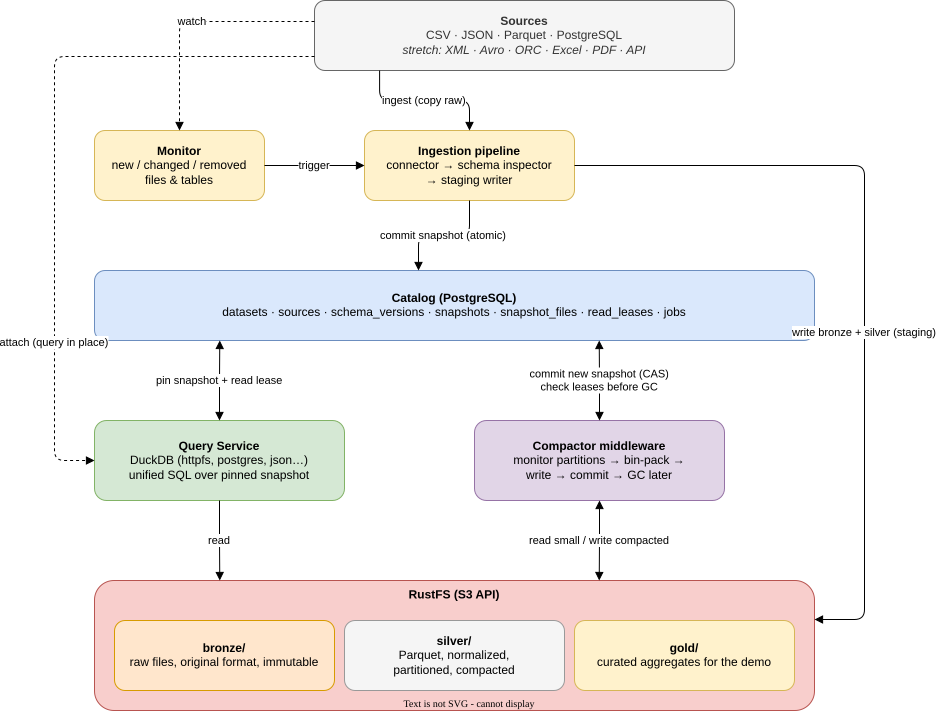

# Architecture

> **Status:** proposal (2026-11-25). Not implemented yet.

## Goal

A small lakehouse where **DuckDB** runs unified SQL over immutable **Parquet** files in **RustFS** (S3). A **PostgreSQL** catalog acts as the transaction log. We build the three core mechanisms ourselves:

1. **Schema evolution:** detect schema changes and adapt ingestion and queries.
2. **Small-file compaction:** a background middleware that merges small files into optimally sized Parquet files.
3. **Snapshot isolation:** compaction never disrupts active queries.

DuckLake / Delta are used only as a **baseline for comparison**.

Source: [`architecture.drawio`](architecture.drawio).

## Components

| Component | Role |
|---|---|
| **Storage (RustFS)** | Immutable Parquet files named by UUID, laid out as `{bronze\|silver\|gold}/{dataset}/{partition}/`. Files are never overwritten. |
| **Catalog (PostgreSQL)** | Datasets, sources, schema versions, snapshots, the files in each snapshot, and read leases. Commits are atomic SQL transactions. |
| **Connectors + ingestion** | One connector per format (`discover()`, `read()`), mostly using DuckDB readers. Flow: raw → `bronze/` → Parquet in staging → commit. Data becomes visible only on commit. |
| **Schema Inspector** | Compares the incoming schema with the current version and classifies the change (see below). |
| **Monitor** | Polls sources for new or changed files and schemas, then triggers ingestion. |
| **Query Service** | Each dataset is a DuckDB view over a **pinned snapshot's file list** (not a glob), held by a read lease while the query runs. |
| **Compactor** | Background process: score partitions → bin-pack small files → rewrite to staging → commit a new snapshot → garbage-collect later. |

## Schema evolution

| Change | Policy |
|---|---|
| Add column / widen type / reorder | Compatible: new schema version; old files read with `union_by_name` + casts |
| Rename | Needs a mapping; otherwise treated as drop + add |
| Drop column | Kept as a nullable column and flagged |
| Incompatible type | Breaking: the file is quarantined and not committed |

Old files are reconciled **lazily** at query time. Compaction rewrites them to the latest schema, so compaction also acts as migration.

## Compaction without disrupting queries

1. Write the new files to staging.
2. Commit in one transaction: new snapshot = old files − inputs + outputs (optimistic check against the base snapshot).
3. Tombstone the inputs. They are deleted only when no read lease references them and the retention period has passed.

**Guarantee:** every query reads one complete snapshot, and no file it is reading is ever deleted.

## Experiments

| Requirement | Evidence |
|---|---|
| Unified SQL | Join across CSV + JSON + Parquet + PostgreSQL |
| Schema evolution | Inject each change class; queries keep working |
| Compaction | 10k small files before vs after: file count and latency; target-size sweep |
| Consistency | Query loop during compaction: 0 errors, identical results |

## Open decisions

- Stretch formats (Excel, XML, Avro, ORC, API, PDF) given about 20 h per student.
- GC by leases or by retention time only.
- Run a spike to confirm RustFS works with DuckDB `httpfs` (globbing, multipart writes).
